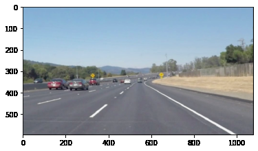
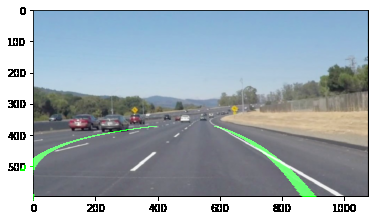
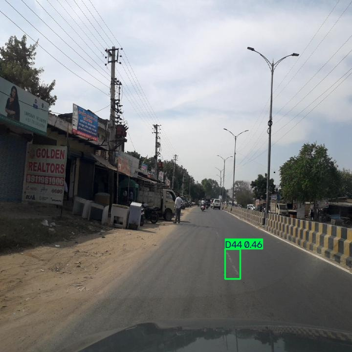
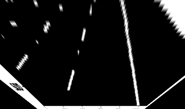

# 🚗 Road Damage and Lane Detection System

An AI-powered computer vision project that combines **road damage detection and lane detection** using Python, OpenCV, and YOLO. The project explores how image processing and deep learning can support road condition monitoring and intelligent transportation systems.

## 📌 Project Overview

Road damage, such as cracks and potholes, can affect road safety and driving comfort. Lane detection is also an important component of driver-assistance systems.

This project combines two computer vision tasks:

- **Road Damage Detection:** Uses a YOLO-based workflow to identify road damage in images.
- **Lane Detection:** Uses image processing techniques to identify lane markings and visualize lane boundaries.

## ✨ Features

### 🛣️ Road Damage Detection
- YOLO-based object detection workflow.
- Image-based road damage prediction and visualization.
- Model training and prediction scripts.
- Detection result images for demonstration.

### 🛤️ Lane Detection
- Image preprocessing using OpenCV.
- Edge detection and region of interest (ROI) masking.
- Lane boundary detection and visualization.
- Bird's-eye-view transformation.
- Advanced lane detection experiments.

## 🧰 Technologies Used

- **Programming Language:** Python
- **Computer Vision:** OpenCV
- **Deep Learning:** YOLO / Ultralytics
- **Numerical Processing:** NumPy
- **Data Processing:** Pandas
- **Visualization:** Matplotlib
- **Version Control:** Git and GitHub

## 📂 Project Structure

```text
road-damage-lane-detection/
│
├── src/
│   ├── detection/
│   │   ├── predict_road_damage.py
│   │   ├── road_damage_detector.py
│   │   └── train_road_damage.py
│   │
│   ├── lane_detection/
│   │   ├── advanced_lane_detector.py
│   │   ├── advanced_lane_detector_v1.py
│   │   └── lane_detector.py
│   │
│   └── utils/
│       ├── rdd2022_to_yolo.py
│       └── verify_yolo_labels.py
│
├── docs/
│   └── images/
│       ├── lane_detection_result.png
│       ├── advanced_lane_detection.png
│       ├── road_damage_result.jpg
│       └── birdseye_view.png
│
├── requirements.txt
├── .gitignore
└── README.md
```

*Note: The tree above describes the expected published structure. Adjust filenames or folders if your repository differs.*

## ⚙️ Installation

### 1. Clone the repository

```bash
git clone https://github.com/vishwa-debug/road-damage-lane-detection.git
cd road-damage-lane-detection
```

### 2. Create a virtual environment

```bash
python -m venv .venv
```

Activate it on Windows:

```powershell
.venv\Scripts\Activate.ps1
```

If PowerShell blocks activation, use Command Prompt:

```cmd
.venv\Scripts\activate.bat
```

### 3. Install dependencies

```bash
python -m pip install --upgrade pip
pip install -r requirements.txt
```

## ▶️ Running the Project

The repository contains separate scripts for road damage detection and lane detection. Run them from the project root.

### Road Damage Detection

```bash
python src/detection/predict_road_damage.py
```

### Lane Detection

```bash
python src/lane_detection/lane_detector.py
```

**Important:** These commands assume the scripts are configured to run directly. If a script requires an image path, model checkpoint, or command-line arguments, provide the required inputs as defined in that script. Model weights and datasets may need to be downloaded or configured separately.

## 🖼️ Sample Outputs

Add your actual project output images to `docs/images/` and display them here.

### Lane Detection



### Advanced Lane Detection



### Road Damage Detection



### Bird's-Eye View Transformation



## 🧠 Key Concepts Demonstrated

- Computer vision and image processing
- YOLO-based object detection
- Edge detection and region of interest masking
- Lane boundary identification
- Perspective transformation and bird's-eye-view visualization
- Model training, prediction, and result visualization

## 🚀 Future Improvements

- Improve road damage classification and detection accuracy.
- Evaluate the model using precision, recall, and mAP.
- Add video-based road damage and lane detection.
- Combine both systems into a single demonstration interface.
- Explore real-time camera input and intelligent driver-assistance applications.

## 🎯 Applications

- Road inspection and maintenance
- Road safety monitoring
- Intelligent transportation systems
- Driver-assistance research
- Computer vision learning and experimentation

## 👨‍💻 Author

**Vishwa N**

AI & Machine Learning | Computer Vision | Deep Learning

- GitHub Profile: [vishwa-debug](https://github.com/vishwa-debug)
- Project Repository: [Road Damage and Lane Detection System](https://github.com/vishwa-debug/road-damage-lane-detection)

## 📄 License

Choose a suitable open-source license before publishing this project for reuse. For example, an MIT License can be added if you intend to permit reuse under its terms.
